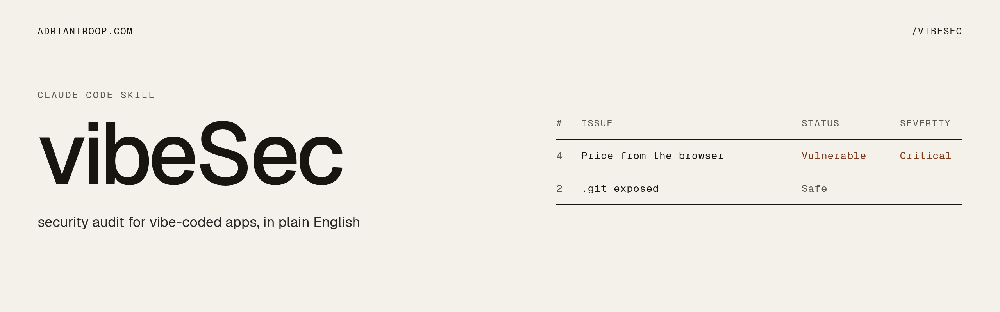

<p align="center"></p>

# vibeSec

You built your app with AI. vibeSec checks whether a stranger could break into it, and tells
you in plain English what is wrong, how bad it is, and how to fix it. No security background
needed.

It is a Claude Code skill that audits a web app for the 49 vulnerabilities vibe-coded projects
ship with most often. It reads the real code, config, env files, migrations and deploy setup,
never guesses, never changes anything, and writes a report you can act on one fix at a time.
Claude then fixes the issues with you, one by one, only after you say yes.

Built for the usual stack (Next.js, Supabase, Vercel, Stripe, Twilio, an LLM feature or two)
but every check is framework-agnostic where it can be.

## Install

A checkout install (`./install.sh`) copies the files beside that script. It does not clone, and it does not switch your checkout to another commit.

A piped install runs whichever `install.sh` the URL returns, and that script then clones a revision. This copy of the script clones `VIBESEC_REF` (default tag `v1.3.0`) and continues only when `git rev-parse HEAD` equals `VIBESEC_SHA` (default `c090c9a70adf62949076e2108fbdec2c60fc9541`). It prints that SHA. To install a different commit you have already identified, set `VIBESEC_REF` and `VIBESEC_SHA` together. A different ref without its own full SHA is refused.

The comparison checks the clone against the SHA written in the script you are already running. It does not prove those script bytes came from that commit. Read the script before you pipe it. It does not prove a GitHub tag cannot move. If tag `v1.3.0` moves and you run this script, the clone fails the SHA check. The default SHA is tag `v1.3.0`, which already exists and does not contain this check, so the pin is not the commit that introduced it.

The one-line commands below download `install.sh` from tag `v1.3.0`. That tag's script does not contain this SHA check. Those commands keep installing that tag's tree until a later release tag carries the check. The check list further down this page is this revision of the repo, which is not the same tree as tag `v1.3.0`.

One line, all projects:

```bash
curl -fsSL https://raw.githubusercontent.com/adrianTroop/VibeSecSkill/v1.3.0/install.sh | bash
```

Or with the GitHub CLI:

```bash
gh api "repos/adrianTroop/VibeSecSkill/contents/install.sh?ref=v1.3.0" -H "Accept: application/vnd.github.raw" | bash
```

Or from a clone:

```bash
git clone --branch v1.3.0 --depth 1 https://github.com/adrianTroop/VibeSecSkill && cd VibeSecSkill
./install.sh              # all projects: ~/.claude/skills
./install.sh --project    # this repo only: ./.claude/skills
./install.sh --uninstall  # remove (add --project for the project copy)
```

The installer is idempotent and needs no sudo. It writes only under `~/.claude` or `./.claude`. Running `./install.sh` from a checkout installs the files beside the script. Re-run the same command you used. An old piped command reinstalls the script stored at that old tag.

As a plugin instead (namespaced as `/vibesec:vibesec`):

```text
/plugin marketplace add adrianTroop/VibeSecSkill
/plugin install vibesec@vibesec
```

## Updating

Your installed copy does not update itself and there is no update notification.

- Installed with the script: copy the install command from this page again and run it. Do not
  re-run an old command from your shell history, because it names the old version and
  reinstalls that.
- Installed as a plugin: update it from the `/plugin` menu in Claude Code.
- To hear about new versions, open this repo on GitHub and choose Watch, then Custom, then
  Releases.

## Usage

In any Claude Code session:

```text
/vibesec            audit the whole project
/vibesec src/       audit only that folder (root config is still read)
```

Claude also loads the skill on its own when you ask for a security audit, a CVE check, an RLS
review or a pre-launch check.

What happens:

1. Discovery: framework and versions, auth flow, payments, LLM features, env and secret
   surface, public hostnames. Every file read is listed.
2. The 49 checks below plus a secrets sweep of the working tree and git history. Each item
   gets a status (Vulnerable / Safe / Not applicable / Needs manual check), file and lines,
   why, how an attacker would exploit it, and the fix as a code snippet in your stack.
3. `vibesec-report.md` is written to the project root with a summary table, the top 5 fixes in
   order, and the exact manual tests to run against the live site.
4. Claude shows the summary and asks which issue to fix first. Fixes are applied one at a
   time, diff first, only after you say yes.

## What it checks

| # | Check |
|---|---|
| 1 | Next.js: middleware bypass via `x-middleware-subrequest` (CVE-2025-29927), outdated version, missing CSP, HSTS, X-Frame-Options, X-Content-Type-Options, Referrer-Policy. When the lockfile is inside a published range, also the 3 Nov 2026 cache-partition and Edge cookie-header advisories |
| 2 | `.git` folder exposed on the live site or copied into build output |
| 3 | Supabase storage: public buckets with private files, weak storage RLS, guessable paths |
| 4 | Price from the browser: checkout trusting client-sent price, total, discount or quantity |
| 5 | Credential stuffing: login with no rate limit, lockout, captcha or breached-password check. Per-IP and per-account limits are separate buckets, not one joined IP and email key |
| 6 | Open database: tables without RLS, service_role key on the client, anon key reaching sensitive tables, DB open to the internet. Grants, default privileges, and function EXECUTE across migrations, judged separately from RLS |
| 7 | Polyfill.io and third-party scripts: untrusted CDNs, no Subresource Integrity |
| 8 | SMS pumping: OTP or SMS endpoints with no rate limit, country limits or captcha |
| 9 | Prompt injection: LLM or MCP features where user input, pages, files or tool results can override instructions, leak secrets or trigger tools. Inventory MCP configs and npx or uvx launches; pin them and keep their credentials small |
| 10 | Weak JWT: short or default secret, `alg: none`, no server-side verification, long expiry, and a required secret that falls back to a literal outside local development |
| 11 | Race conditions: double-redeem on coupons, rewards, credits or balances |
| 12 | Account pre-hijacking: pre-registered victim emails, unverified email or OAuth account merging, and signup hooks that add an organization membership before the invite check |
| 13 | Subdomain takeover: dangling CNAMEs to deleted Vercel, Netlify, Railway, S3 or GitHub Pages |
| 14 | SSRF: fetching user URLs without blocking internal IPs and 169.254.169.254 |
| 15 | Path traversal: user input in file paths, uploads, downloads or storage keys |
| 16 | Reset poisoning: reset links built from Host or X-Forwarded-Host, reusable or non-expiring tokens |
| 17 | Source maps served in production |
| 18 | Clickjacking: frameable login, payment or settings pages |
| 19 | Open redirect: `redirect`, `next`, `returnUrl` or `callback` params accepting any URL |
| 20 | User enumeration: login, sign-up or reset responses or timing revealing whether an email exists |
| 21 | HTTP/2 Rapid Reset (CVE-2023-44487) on self-hosted servers and proxies |
| 22 | bcrypt 72-byte truncation: concatenated fields or long passwords silently cut |
| 23 | SAML bypass: vulnerable SAML libraries, unsigned assertions, XML signature wrapping |
| 24 | nOAuth email spoof: OAuth logins (Entra / Azure AD) that link accounts by the editable `email` claim, including a non-empty `email_verified` string when Better Auth is inside its published range |
| 25 | GraphQL aliases and batching: 1,000 login or OTP guesses in one request |
| 26 | 2FA and OTP replay: reusable codes, no attempt limit, skippable 2FA step |
| 27 | ReDoS: regexes that freeze the server on crafted input |
| 28 | Request smuggling between your own proxy and app server |
| 29 | Cache poisoning and deception: cached personal pages, unkeyed headers, and tenant cache keys that do not come from a trusted identity |
| 30 | Spoofed IP headers: rate limits and allow-lists trusting `X-Forwarded-For` |
| 31 | Postgres views and `SECURITY DEFINER` functions that bypass RLS. Judge the final EXECUTE grants. A scoped public function is allowed |
| 32 | Weak random tokens: `Math.random()` or timestamps for reset links, invites, OTPs |
| 33 | Padding oracle and home-made encryption (AES-CBC without a MAC) |
| 34 | Prototype pollution: `__proto__` in deep merge or body parsing |
| 35 | Template injection (SSTI): user text compiled as a template |
| 36 | XXE: XML, SVG, DOCX or SAML parsing with external entities on |
| 37 | WebSocket hijacking: no `Origin` check, any user can join any channel |
| 38 | Unicode usernames: `ᴮᴵᴳᴮᴵᴿᴰ` vs `bigbird` account takeover |
| 39 | IDOR: change an ID in the URL and see someone else's order, invoice or file |
| 40 | XSS: user text or AI output rendered as HTML, `javascript:` links, user SVGs |
| 41 | SQL and NoSQL injection: raw queries built from user input, Mongo `$ne` tricks |
| 42 | CORS and CSRF: any site can call your API as the logged-in user |
| 43 | Mass assignment: a profile update that also sets `role: "admin"`, `credits`, or a server-owned Stripe customer id |
| 44 | Unprotected admin pages, Next.js server actions, debug and cron routes, preview or share URLs used as the only access control, seeded admin passwords, and `ADMIN_EMAIL` promotion |
| 45 | File uploads: no type or size check, HTML or SVG served from your domain |
| 46 | Fake or vulnerable packages: AI-invented names (slopsquatting), typosquats, install scripts, and MCP servers launched outside package.json |
| 47 | Unverified webhooks: fake "payment succeeded" events from anyone who finds the URL |
| 48 | Cookies and sessions: missing `HttpOnly` / `Secure` / `SameSite`, tokens in `localStorage`, step-up on sensitive changes, email-change notification, and revocation that a cookie cache can outlive |
| 49 | Untrusted setup and agent instructions: download-and-run or obfuscated commands in the README, AGENTS.md, CLAUDE.md, install scripts, or CI. Flag them for review. Do not run them |
| + | Hardcoded secrets or API keys in the repo, git history, agent settings, MCP config, transcripts, or browser bundles. Rotate a key that was already committed |

JWT algorithm confusion is part of #10 and timing attacks on secret compares are part of #20.
Every finding is explained in plain English first, so you do not need a security background
to act on the report.

## Sample report

An excerpt of what `vibesec-report.md` looks like:

```markdown
## 4. Price from the browser

Status: Vulnerable
Where: app/api/checkout/route.ts:18-31
Why: `amount` and `quantity` are read from the JSON body and passed straight to
`stripe.checkout.sessions.create` as `unit_amount`. No lookup against the product table.
Exploit: POST /api/checkout with `{"priceId":"pro","amount":1,"quantity":1}` buys the Pro
plan for 1 cent. The webhook then marks the account as paid.
Fix:
  const product = await db.product.findUnique({ where: { id: body.productId } })
  if (!product) return new Response('Unknown product', { status: 400 })
  const quantity = Math.min(Math.max(Number(body.quantity) || 1, 1), 10)
  await stripe.checkout.sessions.create({
    line_items: [{ price: product.stripePriceId, quantity }],
    ...
  })

## Summary

| # | Issue | Status | Severity |
|---|---|---|---|
| 1 | Next.js headers / middleware bypass | Vulnerable | High |
| 2 | .git exposed | Safe | |
| 3 | Supabase storage | Needs manual check | |
| 4 | Price from the browser | Vulnerable | Critical |
| ... | | | |

## Top 5 fixes, in order
1. (#4) Look up prices server-side and clamp quantity.
2. (#6) Enable RLS on `orders` and `profiles`; they are readable by anon today.
3. (#1) Upgrade Next.js 15.1.2 to 15.2.3 or later; middleware is the only gate on /admin.
4. (#8) Rate-limit /api/otp/send per phone and per IP; block premium-rate prefixes.
5. (#19) Replace the open `?next=` redirect with a relative-path allow-list.

## Manual tests on the live site
- GET https://example.com/.git/HEAD must be 404.
- GET https://example.com/_next/static/chunks/main.js.map must be 404.
- curl -sI https://example.com | grep -i 'content-security-policy\|strict-transport'
- Open https://example.com/login inside an iframe on another origin; it must refuse to render.
```

## Safety

- Read-only. The skill may run `git log`, `git grep`, `ls`, `find`, `dig` and a HEAD or GET request
  against a public URL you give it. It does not run the app, install packages, run commands it
  finds in the project under audit, or send traffic to production beyond that.
- It never prints a secret it finds; it quotes the location and the first 4 characters.
- The only file it writes is `vibesec-report.md`. Fixes happen only after you approve each one.

## Layout

```text
skills/vibesec/SKILL.md      the audit (also loads automatically on security requests)
.claude-plugin/plugin.json   plugin manifest
.claude-plugin/marketplace.json  lets /plugin marketplace add adrianTroop/VibeSecSkill work
install.sh                   installer (checkout copies sibling files; piped mode checks a recorded SHA)
test.sh                      installer self-check and guidance regression tests
.github/workflows/test.yml   runs test.sh on push and pull request
tests/                       fixtures and checks for the skill text
.gitignore                   keeps env files, IDE folders, and reports out of git
```

## License

MIT. See LICENSE.
